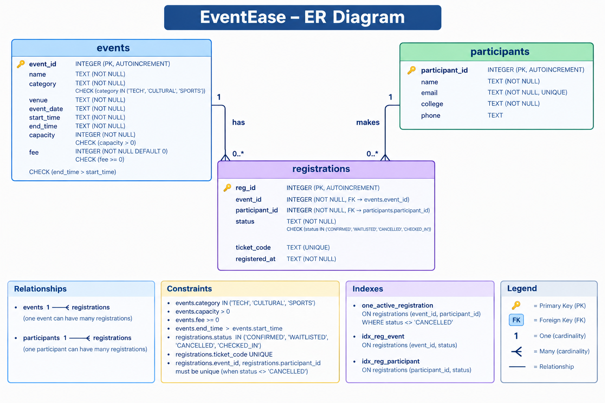

# EventEase - College Fest Event Registration Agent

**Team:** Shivansh Panwar | **Task code:** T7 | **Agent name:** EventEase

## Setup Steps:
1. Install Node.js 20+ (an LTS release is safest)
2. `npm install`
3. Copy `.env.example` to `.env`, add your Gemini key from https://aistudio.google.com/apikey and an organiser PIN
4. `npm run seed`
5. `npm start` 

`package.json` lists dependencies as `latest`. After a successful install you can pin them by re-running:
`npm install langchain @langchain/core @langchain/google-genai @langchain/langgraph zod better-sqlite3 dotenv`

## List of Tools:
list_events , register_participant , register_for_event , cancel_registration , get_my_registrations , check_in , event_stats

## ER Diagram:
