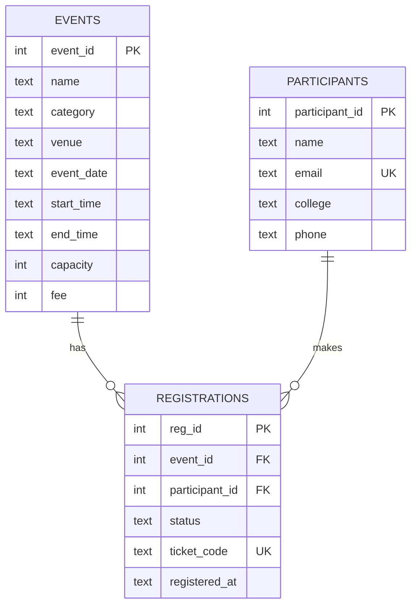

Team Name: Shivansh Panwar 
Task Code: T7 
Agent Name: EventEase

Setup Steps:
1. Install Node.js 20+
2. npm install
3. npm install langchain @langchain/core @langchain/google-genai @langchain/langgraph zod better-sqlite3 dotenv
4. Add your Gemini Free API Key and an organiser PIN in .env file
5. npm run seed
6. npm start

List of Tools:
list_events , register_participant , register_for_event , cancel_registration , get_my_registrations , check_in , event_stats

ER Diagram:
